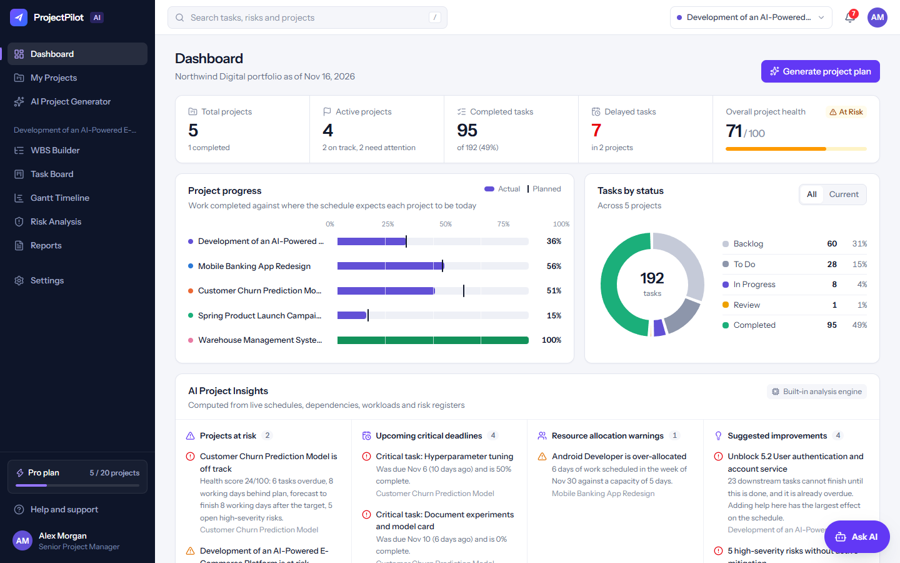
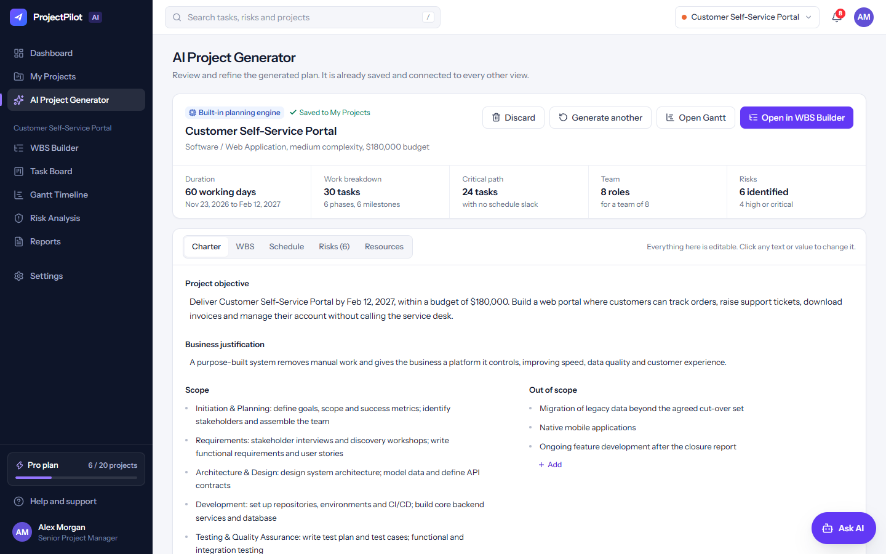
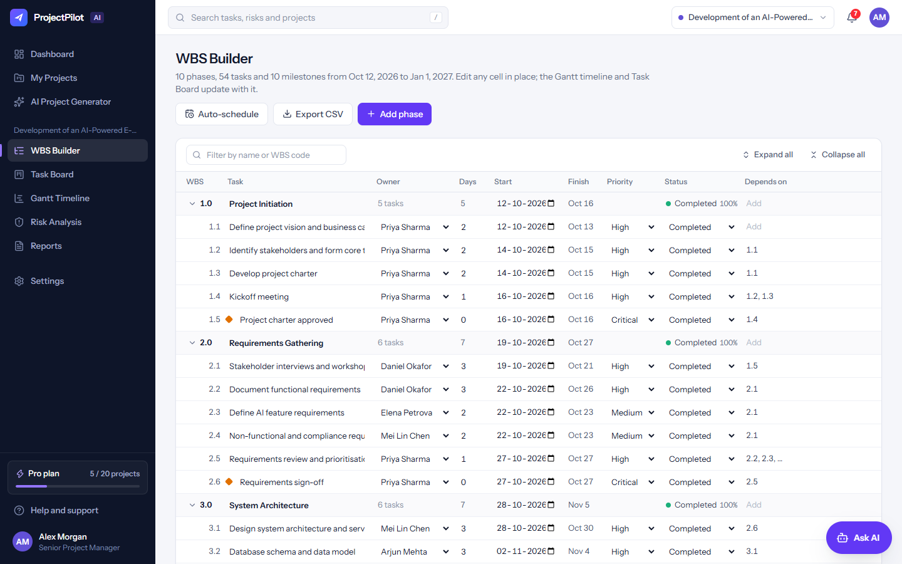
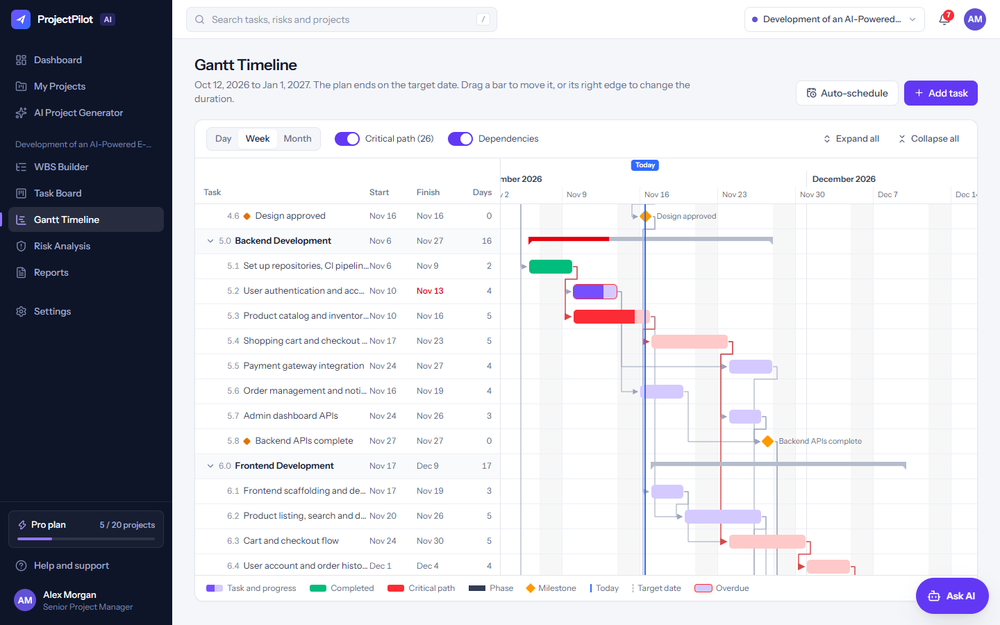
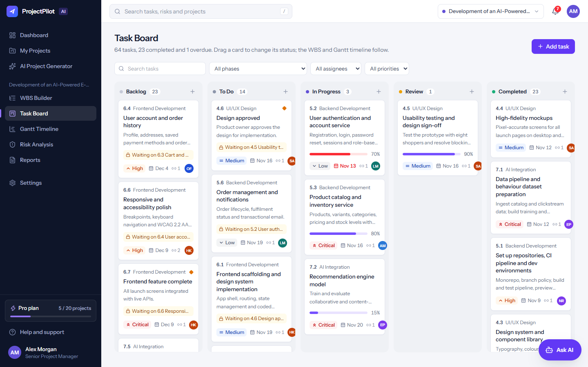
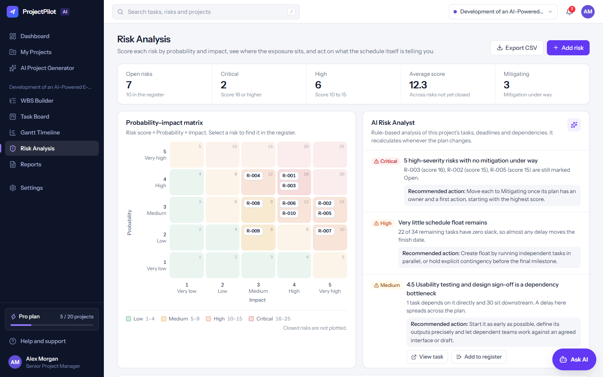
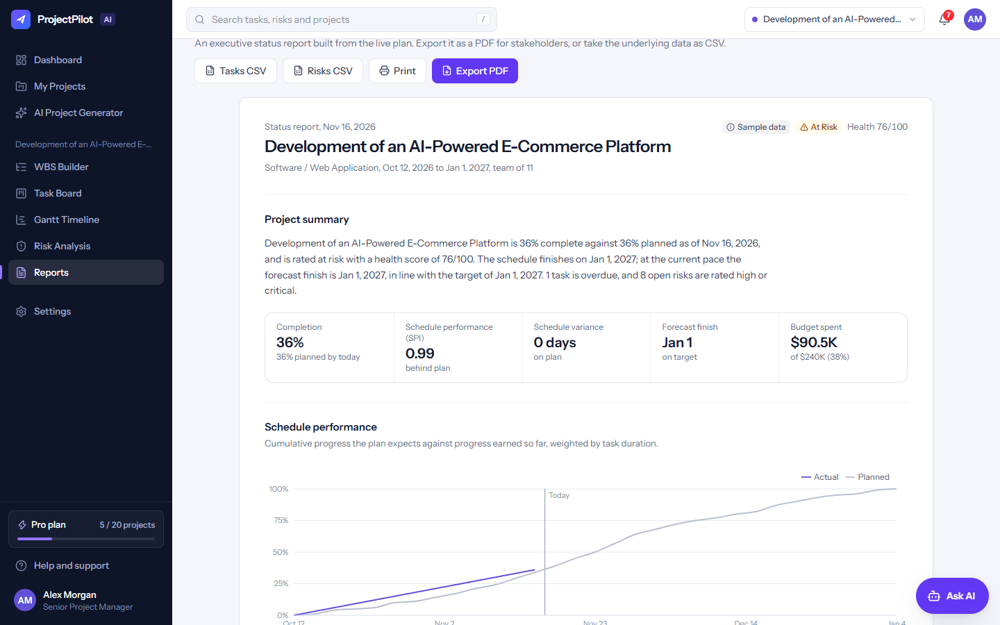
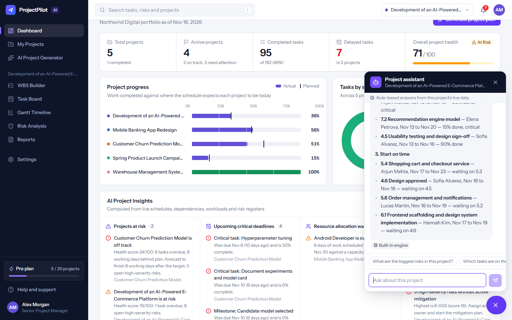

# ProjectPilot AI

**Turn a project idea into a complete, editable project plan, then run the project from it.**

ProjectPilot AI generates a project charter, work breakdown structure, schedule, risk register and resource plan from a short description. From there you manage the work in a WBS builder, Gantt timeline, Kanban board, risk analysis page and executive reports that all read the same data, so a change in one view appears in every other.

   



## Contents

- [Quick start](#quick-start)
- [What it does](#what-it-does)
- [Screens](#screens)
- [How the AI works](#how-the-ai-works)
- [Scheduling model](#scheduling-model)
- [Architecture](#architecture)
- [Testing](#testing)
- [Limitations](#limitations)

## Quick start

Requires Node.js 20 or later.

```bash
git clone https://github.com/iamsammy-ak/projectpilot-ai.git
cd projectpilot-ai
npm install
npm run dev
```

Open http://localhost:5173. There is no backend and nothing to configure.

The first launch loads a sample portfolio of five projects. The main one is the 12-week demo, *Development of an AI-Powered E-Commerce Platform*: 10 phases, 54 tasks, 10 milestones, a team of 11 and 10 risks. Sample dates are generated relative to the day you first open the app, so the demo is always in week 6, with work in progress and one task overdue.

| Command | What it does |
| --- | --- |
| `npm run dev` | Starts the dev server |
| `npm run build` | Type-checks and builds to `dist/` |
| `npm run preview` | Serves the production build |
| `npm test` | Runs the scheduling and generator tests |
| `npm run typecheck` | Type-checks without building |

## What it does

- **Generates project plans.** Enter a name, description, type, dates, team size, budget and complexity. You get a charter, a numbered WBS with durations, owners, dependencies and milestones, a dated schedule, a scored risk register and a resource plan. Everything is editable.
- **Keeps one source of truth.** Edit a duration in the WBS, drag a bar in the Gantt or move a card on the board: dependent tasks reschedule and every view updates.
- **Finds the critical path.** Slack is calculated for every task and the critical path can be highlighted on the timeline.
- **Analyses risk from the plan itself.** Alongside the register and a probability–impact matrix, an analyst flags overdue critical work, dependency bottlenecks, over-allocated people and milestones at risk.
- **Answers questions about the project.** A floating assistant answers from the open project's tasks, dates, dependencies, workload, risks and budget.
- **Reports.** A status report with an S-curve, earned-value budget figures, milestones, risks and recommended actions, exportable as PDF and CSV.

## Screens

### AI Project Generator

Fill in the form and the plan appears in five tabs: Charter, WBS, Schedule, Risks and Resources. The plan is saved as a project straight away and can be edited in place or opened in any other view.



### WBS Builder

A tree-table with hierarchical numbering (1.0, 1.1, 1.1.1). Edit names, owners, durations, start dates, priorities and status in place; add subtasks, reorder, collapse phases, mark milestones and set dependencies.



### Gantt Timeline

Day, week and month views. Drag a bar to move a task, or drag its right edge to change the duration; successors are pushed automatically. Shows dependency arrows, milestones, today and the target date, with an optional critical-path highlight.



### Task Board

Backlog, To Do, In Progress, Review and Completed. Drag cards between columns to change status. Cards show the due date, assignee, priority, progress and which predecessor a task is waiting on.



### Risk Analysis

A risk register scored as probability × impact (1–5 each) and classified Low, Medium, High or Critical, a 5×5 matrix, and an analyst whose suggestions can be added to the register in one click.



### Reports

An executive status report built from the live plan, with PDF export and CSV exports of tasks and risks.



### Project assistant

Ask about risks, the critical path, the deadline, this week's priorities, blockers, workload, budget or a specific task.



## How the AI works

There are two engines, chosen under **Settings → AI engine**. The interface always shows which one produced a plan or an answer.

| | Built-in planning engine (default) | Claude API (optional) |
| --- | --- | --- |
| Setup | None | Your own Anthropic API key |
| Runs | In the browser, offline | Browser calls `api.anthropic.com` directly |
| Plan generation | Project-type templates sized to complexity, team and dates | Claude drafts the charter, WBS and risks |
| Scheduling | Local | Local |
| Assistant | Rules over the project's data | Claude, given the project's data |
| Output | Same inputs give the same plan | Varies between runs |

**Built-in engine.** Plans come from a library of templates for eight project types (software, mobile, AI and data, marketing, construction, research, events and general business). The engine picks a deeper or shallower breakdown for the chosen complexity, schedules tasks through the dependency network, scales durations to fit the target date, and merges or splits roles to match the team size. If the target date cannot be met, the plan says so and shows the date it can meet.

**Claude API.** The key is stored only in the browser's local storage. If a request fails, the app shows the reason and falls back to the built-in engine; a failed call is never presented as a result. This path type-checks against the current Anthropic SDK but has not been run against the live API.

## Scheduling model

- Durations are working days, Monday to Friday. Public holidays are not modelled.
- Dependencies are finish-to-start. A task starts the working day after its predecessors finish. A 0-day milestone lands on the day they finish.
- A phase's dates, status and progress roll up from its tasks. A dependency set on a phase applies to every task in it.
- Changing a date, duration or dependency pushes later tasks wherever a dependency would be broken. **Auto-schedule** also pulls unstarted tasks back to their earliest possible dates.
- A dependency that would create a loop is rejected.
- The critical path is every task with zero slack against the project finish.
- Project health (0–100) combines schedule performance, overdue tasks, open high-severity risks and the forecast against the target date.

## Architecture

```
src/
  types.ts              Domain model
  store.ts              Zustand store: every mutation, activity log, persistence
  router.ts             Hash-based routing
  lib/
    dates.ts            Working-day calendar arithmetic
    schedule.ts         WBS tree, dependency graph, cascade, critical path, health
    risk.ts             Risk scoring and severity bands
    report.ts, pdf.ts   Report data, CSV and PDF export
  ai/
    templates.ts        Project-type knowledge base
    generator.ts        Plan outline -> scheduled project (used by both engines)
    insights.ts         Portfolio insights, workload, risk analyst
    assistant.ts        Rule-based assistant
    claude.ts           Optional Claude API integration
  data/
    repository.ts       Persistence interface and localStorage implementation
    seed.ts             Demo project and sample portfolio
  components/           Layout, UI kit, WBS table, Gantt chart, task drawer, assistant
  pages/                One file per screen
```

All views call `analyze(project)` in `src/lib/schedule.ts`, which returns WBS codes, rolled-up dates, slack, the critical path and health in one pass. That shared result is what keeps the screens consistent.

**Stack:** React 19, TypeScript, Vite, Tailwind CSS 4, Zustand, Recharts, jsPDF, Lucide icons, Vitest.

### Replacing localStorage with a database

Persistence goes through the `WorkspaceRepository` interface in `src/data/repository.ts`:

```ts
export interface WorkspaceRepository {
  load(): Promise<Workspace | null>
  save(workspace: Workspace): Promise<void>
  clear(): Promise<void>
}
```

Implement it against your API and export it as `repository`. The store and the views do not change.

## Testing

`npm test` runs 24 tests over the parts where a mistake would be silent: the working-day calendar, the dependency cascade, loop detection, the critical path, the demo plan (exactly 60 working days, every dependency respected) and the generator, which must fit every project type and complexity to its target date.

## Limitations

- Data is stored in the browser's local storage, per browser and per device. Use **Settings → Data** to export or import a workspace as JSON, or to reset the demo.
- There are no user accounts or collaboration. The subscription indicator is illustrative and no billing is connected.
- Board drag and drop uses native drag events, which touch browsers do not fire. On a tablet, change a task's status from its detail panel.
- The calendar has no public holidays and no per-person time off.
